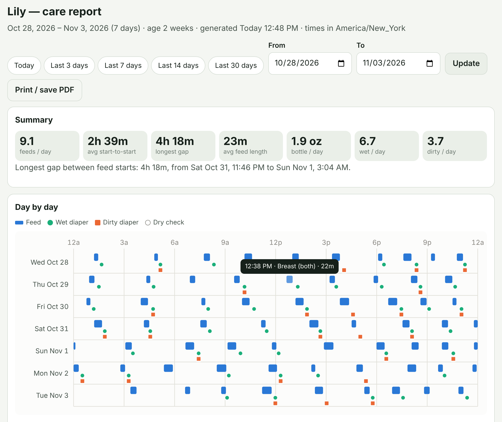
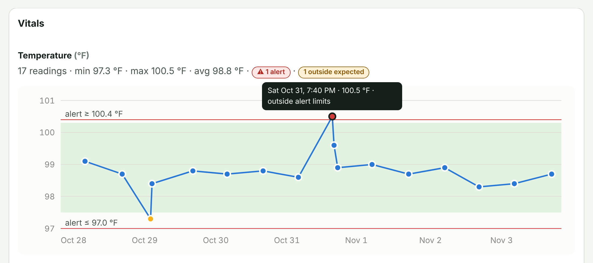
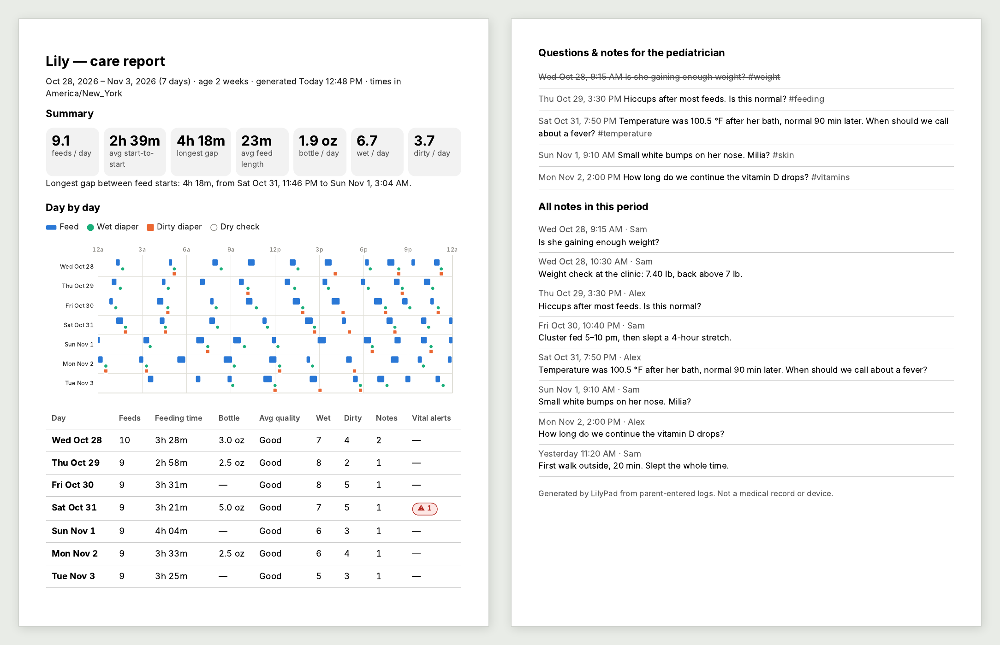

# LilyPad

A self-hosted care tracker for a newborn, built for sleep-deprived parents:
**one tap to log, no password to type, and a clear answer to "when did she
last eat?"** Runs as a single Docker container on your home network.

- **Feeds**: one-tap timers for left/right (switch sides mid-feed and it's
  logged as both), bottle amounts (ml or oz), duration, how it went
  (poor → great) and notable issues (spit-up, poor latch, fussy…). Suggests
  the next breast side from the one you finished on.
- **Diapers**: one-tap wet; dirty with colour, consistency and amount.
  Gently flags stool colours worth a call to the pediatrician. Optional
  one-tap buttons on the dash, too.
- **Vitals you define**: temperature, weight, heart rate, SpO₂, anything.
  Each parameter has a unit, an expected range and alert limits; alert
  readings notify immediately. Show the time since each check, its date
  and time, or both.
- **Notes**: jot observations, tag them, and mark questions for the
  pediatrician. They collect in the report for your next visit.
- **Reminders on your schedule**: custom intervals for feeds, diapers,
  vitals or any routine (vitamin D, medicine…), with a heads-up window
  ("feeding window open"), repeats while overdue, active hours and snooze.
- **Notifications**: [ntfy](https://ntfy.sh) push to your phones, plus a
  live **dash** display (`/dash`) for a wall tablet, messages straight to
  [Dash](https://github.com/loganrf/dash) LED clocks, and an optional
  webhook for Home Assistant and friends.
- **Reports & exports** (password protected): day-by-day 24-hour charts,
  feed intervals, stool patterns, vitals trends, a printable pediatrician
  summary, CSV/JSON/SQLite exports. [See an example](#example-report).
- **Night mode**: a dim red theme for the 3 a.m. feed, per device.
- **Installable app**: put LilyPad (and the dash) on your home screen. It
  opens in its own window, with shortcuts for logging and a friendly
  screen when you're out of range.

> **Privacy first:** logging is deliberately password-free, so anyone who
> can reach LilyPad can see and change recent entries. Settings, reports,
> exports and older history require the admin password. **Read
> [docs/PRIVACY_AND_SECURITY.md](docs/PRIVACY_AND_SECURITY.md) before
> deploying.** In short: keep it on your home network or a VPN; never
> port-forward it.

LilyPad is a record-keeping tool, not a medical device or medical advice.

## Example report

These pictures show a 7-day report for a two-week-old baby. All of the
data is sample data. Open the report from **Admin → Report**.



**Summary and day by day.** Each row is one day, from midnight to
midnight. Blue bars are feeds, green dots are wet diapers and orange
squares are dirty diapers. Point to a mark, or tap it, to see its details.



**Vitals trends.** There is one chart for each vital. The green band is
the expected range and the red lines are the alert limits. A yellow dot
is outside the expected range. A red dot is at or beyond an alert limit.



**Printed report.** **Print / save PDF** removes the menus and buttons.
Page 1 has the summary and the daily totals. The last page lists your
questions for the pediatrician (questions you discussed are crossed out)
and all notes. The other pages show feeding details, stool colours and
consistency, routines and all vitals.

---

## Quick start

Requirements: a machine on your home network with Docker and Docker Compose
(a Raspberry Pi 4, NAS or old laptop is plenty).

```sh
git clone <this repo> lilypad && cd lilypad
cp .env.example .env          # set TZ to your time zone
docker compose up -d --build
docker compose logs lilypad | grep -i password
```

Open `http://<that-machine's-IP>:8080` on each phone and install it as an
app: on iPhone, **Share → Add to Home Screen**; on Android, **Install
LilyPad as an app** at the bottom of the page. Android and computers need
an `https://` address for a full install. See
[docs/INSTALL_APP.md](docs/INSTALL_APP.md) for both.

The log line shows a generated **admin password** (also saved as
`INITIAL_ADMIN_PASSWORD.txt` in the data volume). Use it to open **Admin**,
then in **Settings**:

1. Set the baby's name and birth date and confirm the time zone.
2. Optionally list caregivers (e.g. `Sam, Alex`) so each phone can pick
   "Logging as…".
3. Replace the generated password with your own.
4. Set up ntfy (see [docs/NOTIFICATIONS.md](docs/NOTIFICATIONS.md)) and
   send a test notification.
5. Review **Reminders** (a 3-hour feeding reminder is on by default) and
   **Vitals** (example Temperature and Weight parameters; confirm limits
   with your pediatrician).

### Day to day

| To… | Do this |
|---|---|
| Start a breastfeed | Home → **▶ Left** / **▶ Right** (the suggested side is highlighted) |
| Switch sides | Tap the other side under the timer. The feed is logged as **both**; the next suggestion starts from the side you finished on |
| Finish it | **Stop feed** (it's saved). Optionally rate it, add notes, then **Save feed** |
| Log a bottle | **Bottle** → **Save** at the top, after tapping an amount chip below it |
| Log a feed after the fact | **Log a past feed** → "30m ago" chip → duration chip |
| Log a wet diaper | **Wet** (one tap, done), on the home screen or the dash (if its diaper buttons are on) |
| Log a dirty diaper | **Dirty** → colour, consistency → **Save** |
| Fix a mistake | **Undo** in the green bar, or **Edit** on any recent entry |
| Take a temperature | **Log vitals** (the form warns live if it's out of range) |
| Remember to ask the doctor | **Ask the pediatrician** |
| Silence a reminder for now | **Snooze 15m** (home, dash, or the notification) |
| Prepare for a checkup | Admin → **Report** → "Last 14 days" → **Print / save PDF** |

Pages update by themselves when the other parent logs something.

---

## Configuration

Household preferences live in **Admin → Settings**. Deployment options are
environment variables (set them in `.env`):

| Variable | Default | Purpose |
|---|---|---|
| `TZ` | `UTC` | Default household time zone (can be overridden in Settings) |
| `LILYPAD_PORT` | `8080` | Host port (compose only) |
| `LILYPAD_ADMIN_PASSWORD` | *(generated)* | Fixed admin password. When set, the in-app password change is disabled |
| `LILYPAD_ALLOWED_HOSTS` | `*` | Host names LilyPad answers to, comma separated, wildcards allowed (`*.home.arpa`). **Recommended** — blocks DNS rebinding |
| `LILYPAD_ALLOWED_ORIGINS` | | Extra origins allowed to submit forms, e.g. `https://lilypad.example.com` when a proxy rewrites the Host header |
| `FORWARDED_ALLOW_IPS` | `127.0.0.1` | Reverse-proxy IPs trusted for `X-Forwarded-*` (real client IPs, HTTPS detection) |
| `LILYPAD_ADMIN_SESSION_MINUTES` | `30` | Admin area idle timeout |
| `LILYPAD_COOKIE_SECURE` | `auto` | `true` to always mark cookies Secure (behind HTTPS) |
| `LILYPAD_DASH_FRAME_ANCESTORS` | `*` | Who may embed `/dash` in an iframe (CSP `frame-ancestors`) |
| `LILYPAD_SECRET_KEY` | *(generated)* | Session signing key; normally auto-generated and stored in the database |
| `LILYPAD_REMINDER_TICK_SECONDS` | `30` | How often reminders are evaluated |
| `LILYPAD_LOG_LEVEL` | `INFO` | Python log level |

Notable in-app settings:

- **Open window** (default 48 h): how far back the password-free pages
  reach. See the privacy guide.
- **Base URL**: how phones reach LilyPad; enables tap-to-open and Snooze
  buttons in notifications.
- **Notification detail**: Minimal / Standard / Detailed.
- **Display → Vitals**: show the time since each check ("2h 15m ago"),
  the date and time of the check ("Today 9:15 AM"), or both.
- **Dash display → diaper buttons**: **Wet**, **Dirty** and **Both**
  buttons on `/dash` (off by default).

## Installing as an app

LilyPad is an installable web app (PWA): its own icon and window,
long-press shortcuts (**Log a feed**, **Log a diaper**, **Timeline**,
**Dash**), and a "Can't reach LilyPad" screen that reconnects by itself.
The dash installs separately as a full-screen app for wall tablets. Only
static files and that generic screen are stored on the device, never care
data. iPhone works over plain HTTP. Android and computers need HTTPS, which
you can set up without exposing LilyPad to the internet:
[docs/INSTALL_APP.md](docs/INSTALL_APP.md).

## Reminders, notifications and the dash

- [docs/NOTIFICATIONS.md](docs/NOTIFICATIONS.md): how reminder timing works,
  vital alerts, ntfy setup, self-hosting ntfy.
- [docs/DASH.md](docs/DASH.md): the built-in `/dash` kiosk page, the
  webhook payload, Dash LED clocks, the `/api/dash` JSON feed, Home
  Assistant examples.

## Backups, restore and upgrades

All data is one SQLite database in the `lilypad-data` volume.

- **From the app**: Admin → Export → *Download database file* (a consistent
  copy, safe while running) or *JSON backup* (no secrets).
- **From the host** (handy for a nightly cron job):
  ```sh
  docker compose exec -T lilypad python -m app.cli backup > lilypad-$(date +%F).sqlite3
  ```
- **Restore** (from either kind of `.sqlite3` backup): stop LilyPad, restore,
  start it again. The file is checked before anything is replaced.
  ```sh
  docker compose stop lilypad
  docker compose run --rm -T lilypad python -m app.cli restore < lilypad-2026-10-28.sqlite3
  docker compose start lilypad
  ```
- **Upgrade**: `git pull && docker compose up -d --build`. The database
  schema migrates automatically on start.

Prefer a folder on the host to a named volume? Replace `lilypad-data:/data`
with `./data:/data` and run `sudo chown -R 10001:10001 ./data` (the container
runs as user 10001).

## Forgotten admin password

```sh
docker compose exec lilypad python -m app.cli reset-password            # prints a new one
docker compose exec lilypad python -m app.cli reset-password --prompt   # choose one
```

If `LILYPAD_ADMIN_PASSWORD` is set, change it in `.env` and run
`docker compose up -d` instead.

## Remote access

Use a VPN (Tailscale, WireGuard…) rather than opening a port. If LilyPad
must be on the internet, put it behind a reverse proxy **with
authentication for every page** and HTTPS. Details and proxy settings are
in [docs/PRIVACY_AND_SECURITY.md](docs/PRIVACY_AND_SECURITY.md#3-recommended-deployments).

---

## Development

```sh
python -m venv .venv && . .venv/bin/activate
pip install -r requirements-dev.txt
LILYPAD_DATA_DIR=./data LILYPAD_ADMIN_PASSWORD=dev uvicorn app.main:_app_from_env --factory --reload --port 8080
pytest
```

Stack: Python 3.13, FastAPI, Jinja2 templates, SQLite, vanilla JS (no build
step, no third-party front-end assets). Every form works without
JavaScript; scripts only add conveniences (live timers, live refresh,
show/hide fields).

```
app/
  main.py          app factory, request guard (host/origin checks, headers), reminder loop
  routes/open.py   password-free pages: home, logging forms, timeline, dash
  routes/api.py    /api/dash JSON, /api/events SSE, snooze/ack, /healthz
  routes/admin.py  password-protected settings, reminders, vitals, history, report, export, trash
  reminders.py     reminder engine and notification text
  notify.py        ntfy, dash webhook, Dash clock and live-dash delivery
  dash_clock.py    Dash LED clock messages: text width, scroll timing
  reports.py       report aggregation and SVG charts
  security.py      password hashing, signed sessions, CSRF, throttling, origin checks
  db.py            schema and migrations
  templates/, static/   (templates/sw.js + static/pwa.js: installable app / offline page)
docs/              privacy & security, notifications, dash integrations, installing as an app
  images/          README screenshots (sample data)
tests/             pytest suite
```
